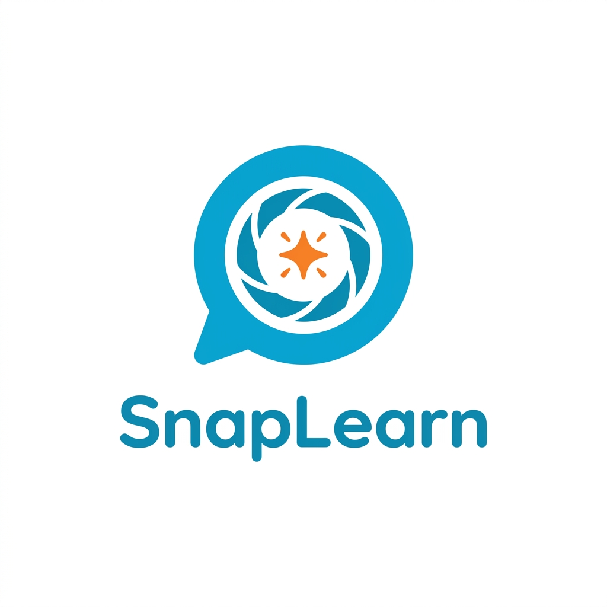

<p align="center">
  
</p>

<h1 align="center">SnapLearn — AI-Powered Vocabulary Camera</h1>

<p align="center">
  <strong>Turn passive screen time into active vocabulary building</strong><br/>
  Point your camera at anything, capture the word, learn to pronounce it, build your collection.
</p>

<p align="center">
  
  
  
</p>

<p align="center">
  
</p>

---

## The Problem

Smartphones are everywhere. Kids use them to consume passive, low-value content on TikTok and YouTube. Parents feel guilty but have no compelling alternative.

In Vietnam specifically:
- **8 million** kids aged 6-10 learning English
- Parents spend **$50-200/month** on tutoring
- Between classes? Zero engaging practice
- Result: Vietnam ranks **58th globally** in English proficiency

## The Solution

<p align="center">
  
</p>

SnapLearn turns that same smartphone into an active exploration tool:

1. **📷 Snap** — Point camera at any object
2. **🤖 Learn** — AI identifies it in Vietnamese + English
3. **🔊 Listen** — TTS plays the pronunciation
4. **🎤 Speak** — Child pronounces the word
5. **⭐ Collect** — AI checks pronunciation, awards points, adds to collection

Kids explore, collect, level up, and compete — **Pokémon Go for vocabulary.**

<p align="center">
  
</p>

## Demo Video

[Coming soon]

## Tech Stack

| Layer | Technology |
|-------|-------------|
| **Frontend** | Next.js 14 PWA + TypeScript |
| **Styling** | Tailwind CSS + Framer Motion |
| **Backend** | FastAPI (Python) |
| **AI Orchestration** | BAML (type-safe LLM functions with fallback chains) |
| **Vision AI** | GPT-4o → Gemini Flash → Claude Sonnet |
| **Text-to-Speech** | OpenAI TTS |
| **Speech-to-Text** | OpenAI Whisper |
| **Database** | Supabase (PostgreSQL) |

## Quick Start

### Run on Your Phone 📱

#### Step 1: Same WiFi
Connect your **computer** and your **phone** to the **same WiFi** network.

#### Step 2: Start the App
```bash
cd app/fe
npm run dev -- --host
```

#### Step 3: Find the Address
Look for the **Network** URL in terminal output:
```
Local:   http://localhost:5173
Network: http://192.168.1.5:5173  ← Use this one
```

#### Step 4: Open on Phone
Open your phone browser, type the Network address, and start capturing!

### Full Setup

#### Prerequisites

- Node.js 18+
- Python 3.11+
- Supabase account
- API keys: OpenAI (GPT-4o, Whisper, TTS), OpenRouter (fallback)

#### Backend

```bash
cd app/be
python -m venv venv
source venv/bin/activate
pip install -r requirements.txt
cp ../../.env.example .env  # Add your API keys
uvicorn app.main:app --reload
```

#### Frontend

```bash
cd app/fe
npm install
npm run dev
```

#### Environment Variables

```bash
# .env
OPENAI_API_KEY=your_key
OPENROUTER_API_KEY=your_key
SUPABASE_URL=your_url
SUPABASE_ANON_KEY=your_key
```

## Features

### Core Loop (Hackathon MVP)
- 📷 **Camera capture** — Point and snap any object
- 🤖 **AI identification** — Vision API recognizes objects in Vietnamese + English (GPT-4o with fallback chain)
- 🔊 **Audio playback** — OpenAI TTS speaks both languages
- 🎤 **Pronunciation check** — Whisper validates speech ("if the AI understands you, a native speaker would too")
- ⭐ **Rarity & points** — Common → Uncommon → Rare → Epic → Legendary
- 📖 **Words Vault** — Collection of captured vocabulary cards
- 🏆 **Leaderboard** — Global ranking

### The Innovation

The camera creates **shared visual context** between child and AI. The snap is a disguised prompt — the child doesn't feel like they're talking to a chatbot. The AI feels proactive, responding to a shared discovery in the real world.

### Coming Soon
- 🇨🇳 Chinese language support
- 🎯 Daily/weekly missions
- 👨‍👩‍👧 Parent dashboard
- 🏫 School deployments
- 💬 Conversational AI ("Is that your cat? What's its name?")
- 🧸 Hardware devices (SnapBear plush toy)

## Team

We're 4 enterprise AI engineers who build AI systems professionally. For this hackathon, we challenged ourselves with a consumer problem — where the user is a 6-year-old who can't read and the UX must be purely intuitive.

| Name | Role |
|------|------|
| TBD | Product & Design |
| TBD | AI Engineer |
| TBD | AI Engineer |
| TBD | AI Engineer |

## Why We Built This

> "My daughter is two and a half. She already grabs my phone and demands YouTube. I wanted to build something where handing over the phone feels like good parenting — not guilt."

## License

MIT License — See [LICENSE](LICENSE) for details.

---

<p align="center">
  Built with ❤️ for Vietnamese kids learning English | <a href="https://lotushack.dev">LotusHack 2026</a>
</p>
